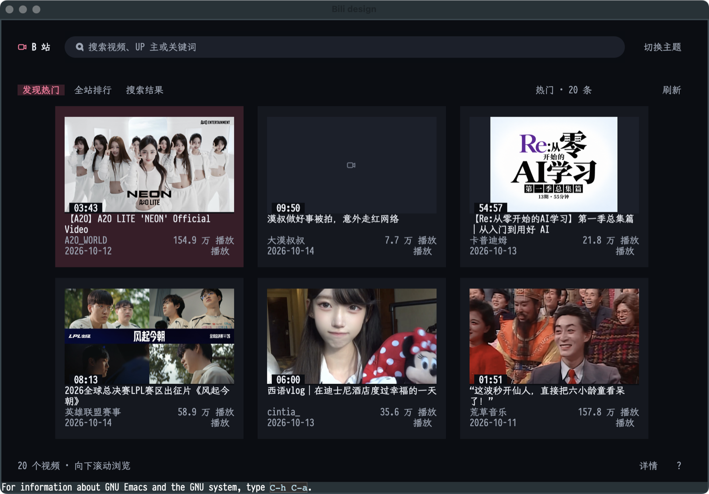

# ETAF Bili

Browse Bilibili inside Emacs: real cover cards, inline search, popular videos
and rankings, with playback in the same buffer. Built with
[ETAF](https://github.com/emacs-taf/etaf) and its UI catalog.



[Light theme](examples/etaf-bili-light.png)

## What it does

- A responsive one-to-four-column cover gallery, with aspect-preserving
  thumbnails, readable two-line titles, creator, duration and compact counts.
- A catalog SearchField, channel Tabs and continuous wheel/trackpad scrolling. Metadata
  opens in a Drawer instead of reserving an empty sidebar.
- Skeleton cards during the first load, readable error/retry and empty states,
  a scoped loading animation and a short selection transition. The shared
  `etaf-animation-enabled` switch disables motion.
- Dark and light application palettes without modifying the user's frame,
  title bar or theme. Minimum usable window: **64 columns × 28 lines**;
  smaller windows deliberately clip rather than compress the controls.
- Asynchronous public-feed requests and at most three concurrent cover
  downloads. Covers are cached locally; failure leaves a usable placeholder.
- `RET` or a card's play button resolves its stream and opens the catalog
  media viewer with the CDN headers required for playback.

This is an unofficial public-video client, not the Bilibili open platform.
Login, account libraries, comments, danmaku and entitlement management are
not implemented. Available quality and playback depend on the server.

## Install

Requires Emacs 29.1+, `etaf`, `etaf-ui`, `ebox`, `ecss`, curl, and ffmpeg
(with ffprobe and ffplay for video metadata and sound).

```elisp
(dolist (package '("ecss" "ebox" "etaf" "etaf-ui" "etaf-bili"))
  (add-to-list 'load-path (expand-file-name package "/path/to/checkouts")))
(require 'etaf-bili)
(etaf-bili-open)
```

## Use

| Key | Action |
| --- | --- |
| `/` | Edit the in-page search field; Return submits, Escape keeps the draft |
| Arrow keys | Move through cards in two dimensions |
| `n` / `p` | Next / previous video (`j` / `k` also work in the default direction scheme) |
| `RET` | Activate the focused control or play the selected video |
| Wheel / trackpad | Scroll through the loaded results continuously |
| `1` / `2` | Popular feed / ranking |
| `g` | Refresh |
| `i` | Open details |
| `T` | Switch application theme |
| `?` / `M-g` | Framework help / region navigation |
| `q` | Close the current modal first, then the client |

The media viewer owns playback keys while open: Space toggles playback,
Left/Right seek, `m` toggles sound, `.` cycles speed and `n`/`p` switch videos.

## Documentation and checks

- [Manual](docs/manual.md): workflows, caching, failure recovery and integration.
- [Architecture](docs/architecture.md): data ownership, scoped UI and lifecycle.
- [Entry Commentary](etaf-bili.el): authoritative supported API.

```sh
make test     # offline public acceptance suite, including mounted catalog controls
make check    # structure, byte compilation, acceptance and API boundaries
```

GUI scenarios live in `scripts/etaf-bili-gui-scenarios.el`; the workspace
performance driver loads `benchmarks/performance-scenarios.el` for the
`bili.appearance` and `bili.scroll` workloads. Screenshots and batch tests are not latency
certification; use the real GUI workflow in the manual.
